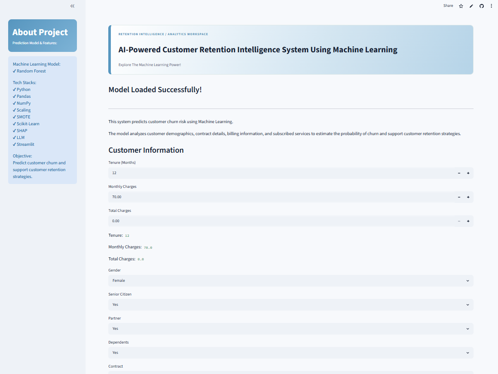
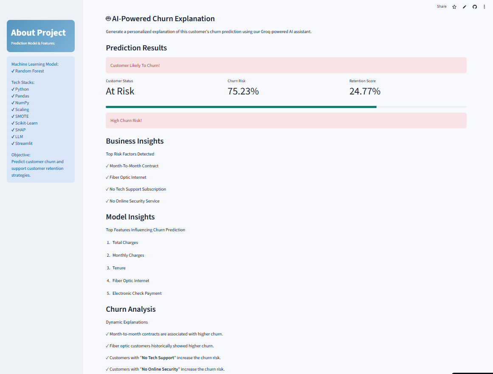
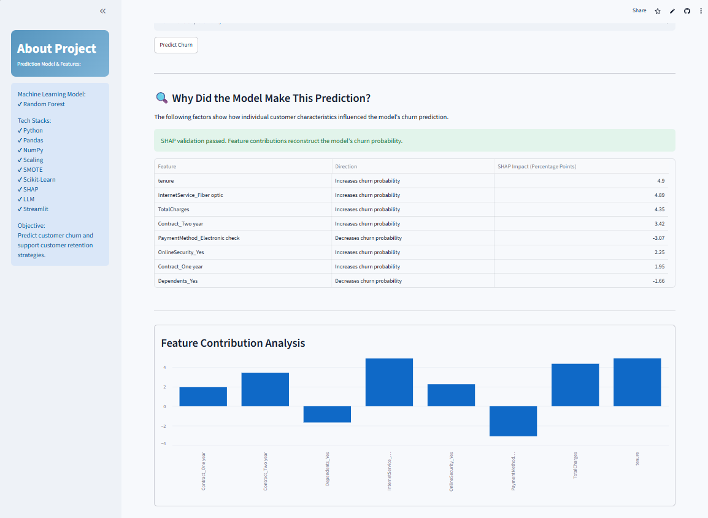
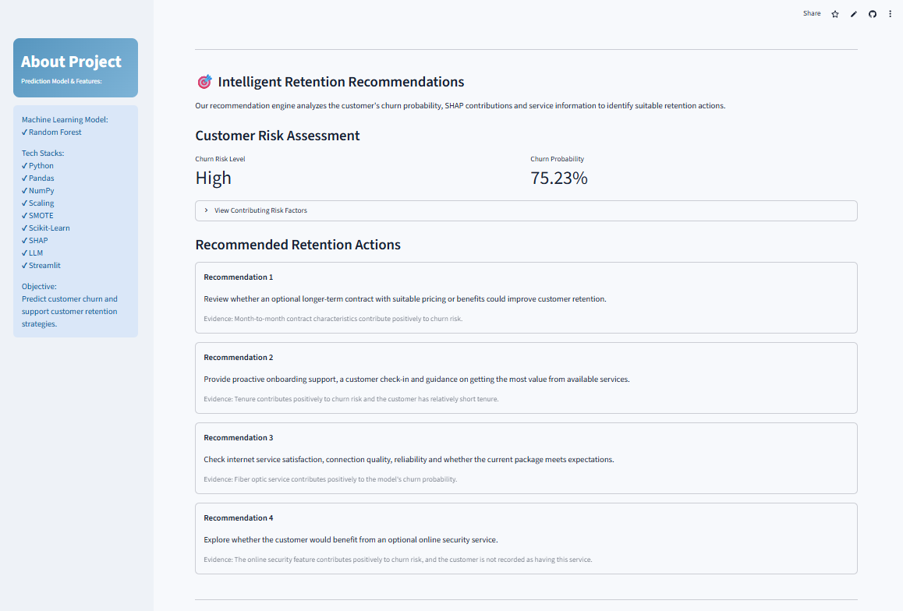
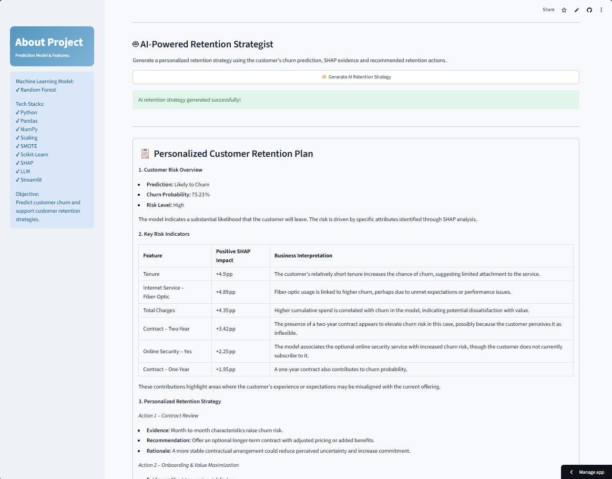
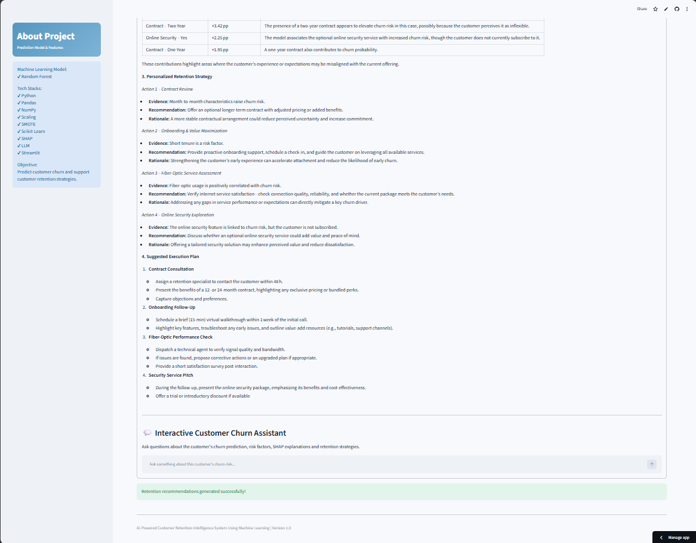

# GenAI-Powered Customer Churn Prediction Assistant

## 🚀 Live Demo

Try the deployed application:

[Launch GenAI Customer Churn Prediction Assistant](https://aslymoulana2000-gen-ai-customer-churn-prediction-ass-app-tcwlv5.streamlit.app/)

An AI-powered customer retention application that combines Machine Learning, SHAP explainability and Generative AI to predict customer churn, understand why customers may leave, and recommend actionable retention strategies.

## Application Screenshots

### Dashboard


### Customer Churn Prediction


### SHAP Explainability


### AI-Powered Retention Strategy


### Conversational AI Assistant



## Project Overview

Customer churn is a significant challenge for subscription-based and service-oriented businesses. Identifying customers who are likely to leave gives businesses an opportunity to take proactive action and improve customer retention.

This project transforms a traditional customer churn prediction model into an intelligent customer retention assistant.

It uses a trained Random Forest classifier to predict customer churn risk, SHAP to explain individual predictions, and GroqCloud LLM integration to generate AI-powered explanations, personalized retention strategies and conversational assistance.

The application is built with Streamlit and provides an interactive interface for exploring predictions and retention insights.

## Machine Learning Model Workflow

##  Features
- Data preprocessing and cleaning
- Exploratory Data Analysis (EDA)
- Feature engineering
- Handling imbalanced datasets
- Model training and evaluation
- Hyperparameter tuning
- Prediction system for new data

---

##  Machine Learning Models Used
- Logistic Regression
- Random Forest Classifier


---

##  Evaluation Metrics
- Accuracy
- Precision
- Recall
- F1-score
- ROC-AUC Score

---

## Key Features

### 1. Machine Learning-Based Churn Prediction
- Predict whether a customer is likely to churn.
- Estimate individual customer churn probability.
- Use a trained Random Forest classification model.
- Load saved model and preprocessing artifacts for predictions.

### 2. SHAP Explainability
- Explain individual customer predictions.
- Identify the features contributing to churn risk.
- Understand factors that increase or decrease predicted churn probability.
- Provide interpretable insights instead of relying on predictions alone.

### 3. Generative AI Explanations
- Integrate GroqCloud LLM services.
- Convert model predictions and SHAP insights into natural-language explanations.
- Help users understand why a customer may be at risk of leaving.

### 4. Intelligent Retention Recommendations
- Generate retention recommendations based on customer churn risk.
- Use model predictions and SHAP insights to identify important churn drivers.
- Provide practical, customer-focused retention actions.

### 5. AI-Powered Retention Strategy
- Generate personalized retention strategies using Generative AI.
- Transform analytical findings into actionable business recommendations.

### 6. Conversational AI Assistant
- Interact with an AI-powered customer retention assistant.
- Ask questions about churn predictions and retention insights.
- Receive conversational responses through GroqCloud.

## Technology Stack

| Category | Technologies |
|---|---|
| Programming Language | Python |
| Data Processing | Pandas, NumPy |
| Machine Learning | Scikit-learn |
| ML Model | Random Forest Classifier |
| Explainable AI | SHAP |
| Generative AI | GroqCloud |
| Web Application | Streamlit |
| Data Visualization | Matplotlib, Seaborn |
| Model Persistence | Pickle / Joblib |
| Development Environment | PyCharm |

## Project Architecture

The application follows this general workflow:

1. Customer data is collected through the application.
2. Input data is preprocessed using the saved preprocessing artifacts.
3. The trained Random Forest model generates a churn prediction and probability.
4. SHAP identifies the factors influencing the prediction.
5. The retention engine produces rule-based retention recommendations.
6. GroqCloud generates natural-language explanations and AI-powered strategies.
7. The conversational assistant allows users to explore customer retention insights.

## Project Structure

```text
Gen-AI-Customer-Churn-Prediction-Assistant/
│
├── .streamlit/
│   └── config.toml
│
├── tests/
│   ├── test_model_shap.py
│   └── test_retention_engine.py
│
├── ai_explainer.py
├── ai_retention.py
├── app.py
├── churn_assistant.py
├── churn_model.pkl
├── feature_columns.pkl
├── retention_engine.py
├── scaler.pkl
├── shap_explainer.py
├── test_groq_connection.py
│
├── requirements.txt
├── .gitignore
└── README.md
```

## Model Artifacts

The application uses saved model artifacts to generate predictions without retraining the model every time it starts.

| File | Purpose |
|---|---|
| `churn_model.pkl` | Trained Random Forest classification model |
| `scaler.pkl` | Saved feature scaling object |
| `feature_columns.pkl` | Expected model input feature columns and ordering |

## Installation and Setup

### Prerequisites

- Python 3.11 (recommended)
- Git
- A GroqCloud API key for the Generative AI features

## Model Evaluation Metrics

The machine learning workflow uses standard classification evaluation metrics, including:

- Accuracy
- Precision
- Recall
- F1-score
- ROC-AUC

These metrics help evaluate model performance and understand how effectively the classifier identifies customers at risk of churning.

## Testing

The project includes tests for important application components, including:

- Model and SHAP integration.
- Feature consistency and prediction explainability.
- Retention recommendation logic.

Run the test suite with:

```bash
python -m pytest tests/
```

## Security and Data Privacy

- API credentials are stored separately using Streamlit secrets.
- Secret configuration files are excluded from Git.
- Virtual environments and local development files are excluded from the repository.
- Never commit confidential customer information or private datasets.

## Project Goals

The main goal is to demonstrate how traditional machine learning can be combined with explainable AI and Generative AI to develop a practical business intelligence application.

Rather than simply predicting which customers might leave, the system aims to help businesses understand churn risk and identify suitable retention actions.

---

**Developed as an end-to-end Machine Learning and Generative AI portfolio project.**

---

##  How to Run This Project

```bash
# Clone repository
git clone https://github.com/aslymoulana2000/Gen-AI-Customer-Churn-Prediction-Assistant.git

# Navigate to project folder
cd Gen-AI-Customer-Churn-Prediction-Assistant

# Install dependencies
python -m pip install --upgrade pip
pip install -r requirements.txt

# Run notebook or script
jupyter notebook & google colab